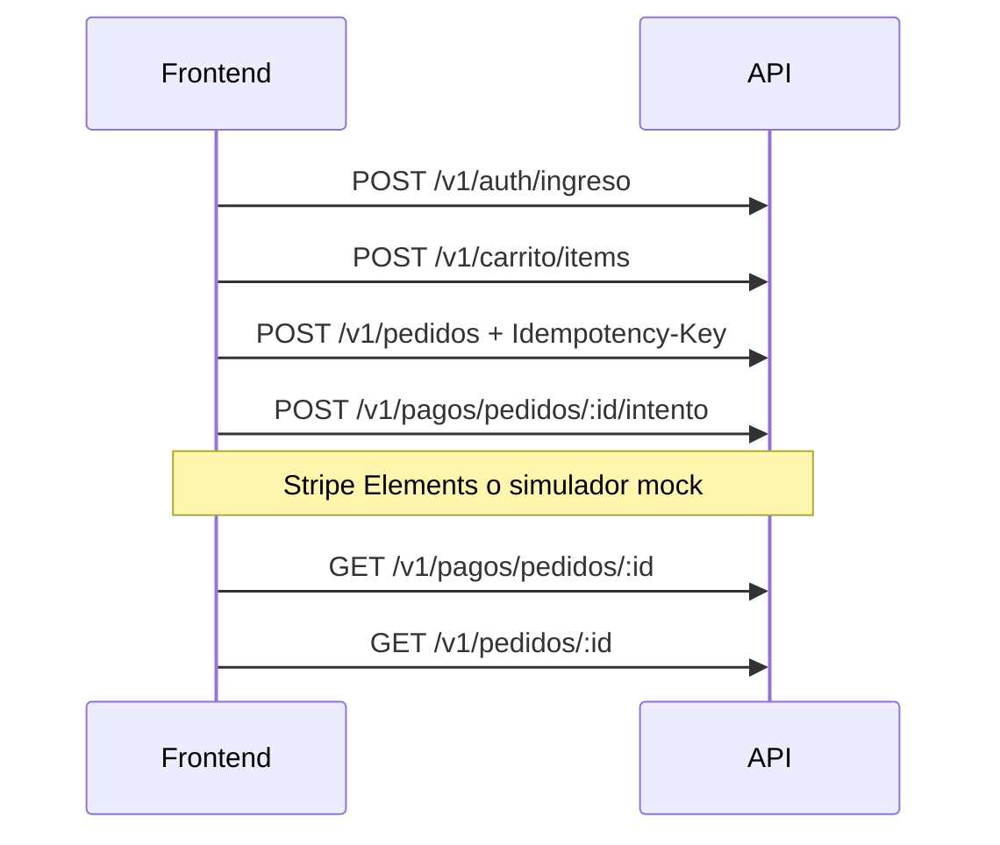

# API — mapa de recursos (MinimalShop)

Contrato que consume este storefront. Prefijo HTTP de la API: `/api`. Versión de negocio: `/api/v1/...`. Salud sin `v1`: `/api/salud/*`.

Schemas request/response: OpenAPI del backend (`/docs`, `/docs-json`). Este documento solo mapea rutas y convenciones del cliente.

Para URLs de entorno, cuentas demo y CORS, usa la guía local `docs/api-connect/` (gitignorada; plantilla en `docs/api-connect.example/`).

## Configuración del cliente

```bash
NEXT_PUBLIC_API_URL=http://localhost:8080/api
# sin barra final → GET ${NEXT_PUBLIC_API_URL}/v1/catalogo/productos
```

Implementación: [`lib/api/`](../lib/api/).

## Autenticación

1. `POST /v1/auth/registro` o `POST /v1/auth/ingreso` → `accessToken`, `refreshToken`, `expiresIn`, `usuario`.
2. Rutas protegidas: `Authorization: Bearer <accessToken>`.
3. Antes de expirar (~15 min): `POST /v1/auth/refrescar` con `{ "refreshToken" }` (rotación; reusar un refresh ya rotado revoca la familia).
4. Salir: `POST /v1/auth/salir` con `{ "refreshToken" }` → 204.

No hay API keys. Throttle auth ~10 req/min; resto ~120/min. Ante **429**, backoff.

Buenas prácticas del cliente:

- Refresh en almacenamiento seguro (preferible httpOnly); un solo reintento tras 401.
- No autorizar UI crítica solo decodificando el JWT: usar `usuario.rol` del login.

## Cabeceras

| Cabecera | Uso |
|----------|-----|
| `Authorization` | Bearer access token |
| `Idempotency-Key` | Obligatoria en `POST /v1/pedidos` (8–100 caracteres alfanuméricos, `-` o `_`) |
| `x-correlation-id` | Opcional en request; la API la expone en response — propagar a logs |
| `Content-Type` | `application/json` salvo subida de imágenes (`multipart/form-data`, campo `archivo`) |

## Paginación

Query: `pagina` (base 0), `tamano` (1–50, default 20).

```json
{
  "contenido": [],
  "pagina": 0,
  "tamano": 20,
  "totalElementos": 0,
  "totalPaginas": 0
}
```

## Errores

Cuerpo uniforme (`RespuestaErrorDto`):

```json
{
  "code": "STOCK_INSUFFICIENT",
  "message": "…",
  "details": [],
  "timestamp": "2026-10-08T20:00:00.000Z",
  "path": "/api/v1/pedidos",
  "correlationId": "uuid"
}
```

El cliente mapea a una unión tipada (`lib/api/errors.ts`) y muestra mensajes de UI seguros (`userFacingMessage`). En pantallas de error de soporte, mostrar `correlationId`.

| HTTP | `code` típico | Acción UI |
|------|----------------|-----------|
| 400 | `VALIDATION_ERROR`, `IDEMPOTENCY_KEY_REQUIRED` | Campos en `details` |
| 401 | `TOKEN_INVALID`, `UNAUTHORIZED` | Refrescar o login |
| 403 | `FORBIDDEN` | Sin permiso |
| 404 | `NOT_FOUND` | Recurso inexistente |
| 409 | `STOCK_INSUFFICIENT`, `MODULE_DISABLED`, `COUPON_*` | Conflicto; no reintentar a ciegas |
| 429 | `TOO_MANY_REQUESTS` | Backoff |
| 503 | `PAYMENT_PROVIDER_UNAVAILABLE` | Reintentar pago más tarde |

## Endpoints principales

### Auth e identidad

| Método | Ruta | Auth | Notas |
|--------|------|------|-------|
| POST | `/v1/auth/registro` | público | `rol`: `COMPRADOR` \| `VENDEDOR` |
| POST | `/v1/auth/ingreso` | público | Sesión con tokens |
| POST | `/v1/auth/refrescar` | público | Rotación refresh |
| POST | `/v1/auth/salir` | público | Revoca refresh |
| GET/PATCH | `/v1/usuarios/yo` | JWT | Perfil |
| GET/POST/DELETE | `/v1/usuarios/yo/direcciones` | JWT | Direcciones |
| GET/PATCH | `/v1/admin/usuarios` | SUPERADMIN | Admin usuarios |

### Catálogo

| Método | Ruta | Auth | Notas |
|--------|------|------|-------|
| GET | `/v1/catalogo/productos` | público | `q`, `categoriaId`, `orden`, paginado |
| GET | `/v1/catalogo/productos/:id` | público | Detalle |
| GET | `/v1/catalogo/productos/:id/resenas` | público | Módulo `resenas` |
| GET | `/v1/catalogo/categorias` | público | Listado |
| GET/POST/PATCH | `/v1/vendedor/productos` | VENDEDOR | CRUD |
| POST | `/v1/vendedor/productos/:id/publicar` | VENDEDOR | |
| PUT | `/v1/vendedor/productos/:id/imagen` | VENDEDOR | multipart `archivo` |
| PUT | `/v1/vendedor/productos/:id/existencias` | VENDEDOR | |
| POST/PATCH/DELETE | `/v1/admin/categorias` | SUPERADMIN | |

### Carrito y pedidos

| Método | Ruta | Auth | Notas |
|--------|------|------|-------|
| GET/DELETE | `/v1/carrito` | COMPRADOR | |
| POST/PUT/DELETE | `/v1/carrito/items` | COMPRADOR | |
| POST | `/v1/pedidos` | COMPRADOR | Header **`Idempotency-Key`** obligatorio |
| GET | `/v1/pedidos`, `/v1/pedidos/:id` | JWT | |
| POST | `/v1/pedidos/:id/cancelar` | COMPRADOR | |
| POST | `/v1/pedidos/:id/recibido` | COMPRADOR | `ENVIADO` → `ENTREGADO` |
| GET | `/v1/vendedor/pedidos` | VENDEDOR | Paginado |
| PATCH | `/v1/vendedor/pedidos/:id/estado` | VENDEDOR | |

### Pagos

| Método | Ruta | Auth | Notas |
|--------|------|------|-------|
| POST | `/v1/pagos/pedidos/:id/intento` | COMPRADOR | Sin confirm del cliente |
| GET | `/v1/pagos/pedidos/:id` | JWT | Estado (`PENDING` \| `SUCCEEDED` \| …) |
| POST | `/v1/pagos/webhook` | público | Firma del proveedor |
| POST | `/v1/pagos/simulador/pedidos/:id/aprobar` | SUPERADMIN | Solo `PAYMENT_PROVIDER=mock` |
| POST | `/v1/pagos/simulador/pedidos/:id/rechazar` | SUPERADMIN | Idem |

Polling sugerido tras el intento: 1–2 s, con tope de reintentos. No asumir pago confirmado hasta `SUCCEEDED` o pedido `PAGADO`.

### Complementos y ops

| Método | Ruta | Auth | Módulo |
|--------|------|------|--------|
| GET/POST | `/v1/vendedor/cupones` | VENDEDOR | cupones |
| GET | `/v1/cupones/:codigo` | público | cupones |
| GET/POST/DELETE | `/v1/favoritos` | COMPRADOR | favoritos |
| GET/POST | `/v1/contenido/…` | mixto | contenido |
| POST/DELETE | `/v1/resenas` | COMPRADOR | resenas |
| GET/PATCH | `/v1/notificaciones` | JWT | notificaciones |
| GET | `/v1/vendedor/metricas` | VENDEDOR | reportes |
| GET | `/v1/admin/reportes/…` | SUPERADMIN | |
| GET/PATCH | `/v1/admin/modulos` | SUPERADMIN | flags |
| GET | `/salud/vida`, `/salud/listo` | público | Terminus |

## Ciclo de vida del pedido

`CREADO` → `PENDIENTE_PAGO` → `PAGADO` → `EN_PREPARACION` → `ENVIADO` → `ENTREGADO`

Terminales: `CANCELADO`, `REEMBOLSADO`.

## Flujo de compra (resumen)



## Tipos TypeScript

```bash
pnpm api:types
# escribe lib/api/schema.d.ts desde OpenAPI
```

Mantén `pagina` / `tamano` y códigos de error alineados con este documento.
